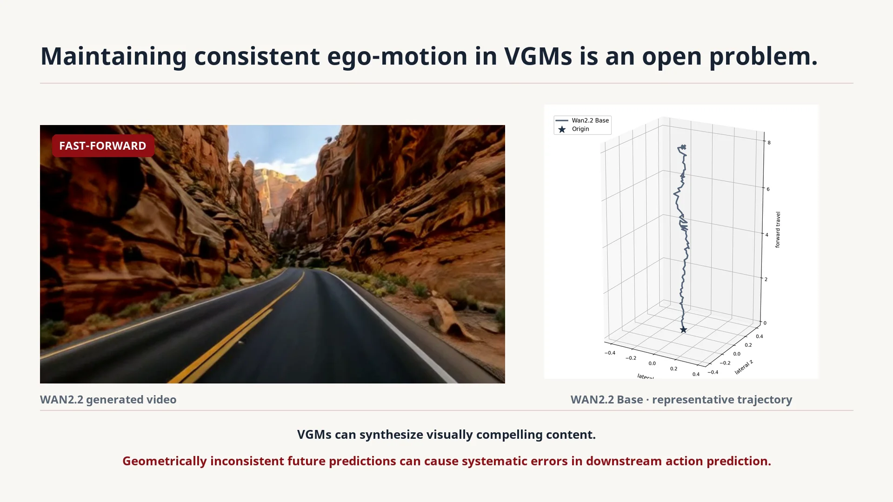

# CausalAlign: Causal Alignment of Video Generation Models for Consistent Ego-Motion

  
  
  

CausalAlign improves the ego-motion consistency of video generation models through causal diagnosis and delta-token alignment.

> The arXiv and Hugging Face links are temporary placeholders pointing to SimRecon. They will be updated when the CausalAlign paper pages are available.

## Demo

[Watch the demo online](https://pku-value-lab.github.io/CausalAlign-homepage/#demo) · [Download the demo MP4](demo/CausalAlign_demo_106s.mp4)

## Code

- Training code: **Stay tuned.**
- Evaluation code: **Stay tuned.**
